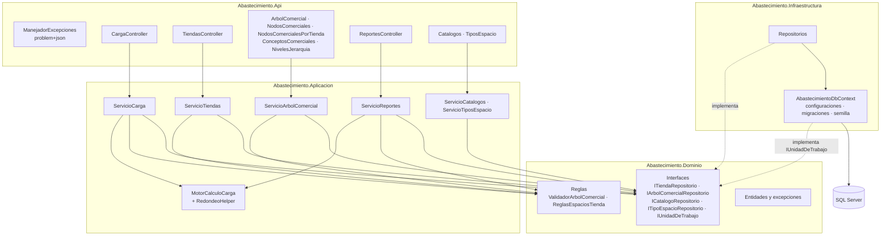
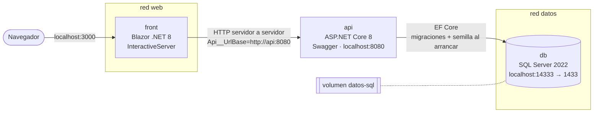
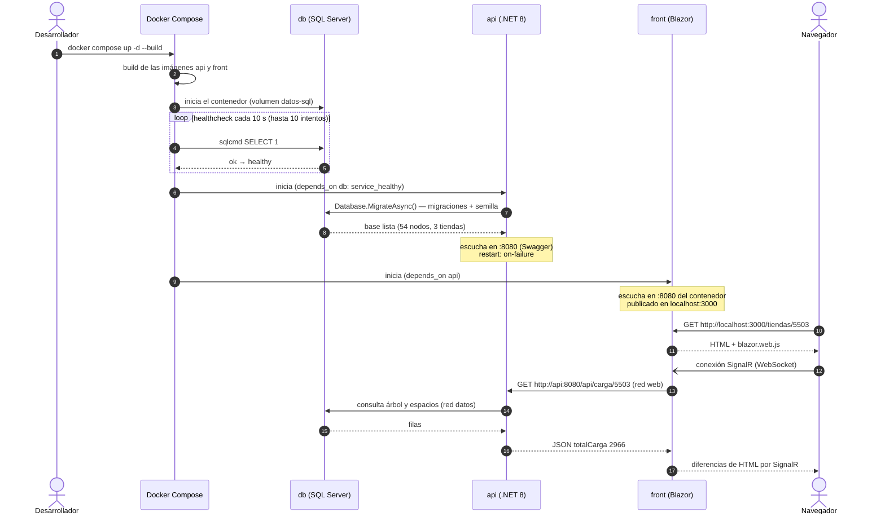

# Abastecimiento Retail — Cálculo de Carga por Tienda

API REST en **.NET 8** que calcula cuántas unidades de cada tipo de producto se envían a una tienda, distribuyendo sus
espacios físicos en cascada por un árbol comercial de 7 niveles. Incluye un front **Blazor .NET 8**. Todo se levanta
con Docker.

| | |
|---|---|
| **Tecnologías** | .NET 8, Clean Architecture, EF Core, SQL Server, Blazor (InteractiveServer) |
| **Pruebas** | **151 backend** (125 unitarias + 26 integración/API) y **117 frontend**, todas pasando |
| **Puertos** | Front `3000`, API/Swagger `8080`, SQL Server `14333` |

### Cumplimiento del enunciado

| Requerimiento | Dónde se cumple |
|---|---|
| **R1** Tiendas y mobiliario, Espacios Totales automáticos | `POST/GET /api/tiendas` · [5.2](#52-diseño-relacional-de-los-7-niveles) |
| **R2** Árbol comercial de 7 niveles | [5.2](#52-diseño-relacional-de-los-7-niveles) |
| **R3** Motor de cálculo en cascada | `Aplicacion/Motor/MotorCalculoCarga.cs` · [6](#6-supuestos-y-regla-de-redondeo) |
| **R4a** Desglose por producto de una tienda | `GET /api/carga/{codigoHanna}` · [3](#3-probar-la-solución) |
| **R4b** Consolidado por Tienda, Marca o Regional | `GET /api/reportes/consolidado` · [4](#4-endpoints-swagger) |
| EF Core, migraciones y semilla al iniciar | [2](#2-migraciones-y-semilla-automáticas) |
| SOLID, Clean Architecture, manejo de excepciones | [5.1](#51-arquitectura-clean-architecture) |
| API documentada con Swagger | [4](#4-endpoints-swagger) |

---

## 1. Compilar y ejecutar

### Con Docker (recomendado)

Requiere Docker ([Anexo A](#anexo-a-instalación-de-docker)).

```bash
git clone https://github.com/kevinandresforero/AbastecimientoPorTiendaRetail.git abastecimiento_retail
cd abastecimiento_retail
cp .env.example .env          # Windows: copy .env.example .env
docker compose pull db
docker compose up -d --build  # la primera vez descarga ~2 GB y tarda 1-2 min
docker compose ps             # db: healthy, api y front: running
```

- Front: **http://localhost:3000**
- Swagger: **http://localhost:8080/swagger**

| Acción | Comando |
|---|---|
| Detener (conserva la base) | `docker compose down` |
| Detener y borrar la base | `docker compose down -v` |
| Ver logs de la API | `docker compose logs -f api` |
| Cambiar el puerto de SQL Server | `SQL_PUERTO=14334 docker compose up -d` |

### Sin Docker

Requiere **.NET 8 SDK** y un **SQL Server** accesible:

1. Instalar el SDK: `winget install Microsoft.DotNet.SDK.8` (Windows), `sudo apt install -y dotnet-sdk-8.0` (Ubuntu) o
   `curl -sSL https://dot.net/v1/dotnet-install.sh | bash -s -- --channel 8.0`.
2. Configurar `ConnectionStrings__Abastecimiento` en `.env`.
3. `dotnet run --project src/Abastecimiento.Api --launch-profile http` → http://localhost:5080/swagger.

---

## 2. Migraciones y semilla (automáticas)

No hay que ejecutar migraciones ni scripts SQL a mano. Al arrancar, la API llama a `Database.MigrateAsync()`
(`Api/Extensiones/ExtensionesMigracion.cs`), que aplica `MigracionInicial` y `ArbolPorTienda`. La semilla va dentro
de las migraciones (`HasData`), así que la base queda poblada desde el primer arranque:

| Dato | Valor |
|---|---|
| Tiendas | **5503** (22 espacios), **1001** (30), **2045** (20) |
| Niveles | 7 (Unidad de Negocio … Tipo de Producto) |
| Conceptos | 15 |
| Nodos | 54 (18 por tienda, mismos conceptos y porcentajes, IDs independientes) |

Para recrear la base desde cero: `docker compose down -v` y `docker compose up -d --build`.

---

## 3. Probar la solución

### Resultado esperado (HANNA 5503, 22 espacios)

Ruta: BELLEZA Y BIENESTAR (100 %) → BEAUTY (30 % = 6,6 esp.) → LILI BEAUTY (94 %) / KARITE (6 %) → GIRLS (100 %) →
MAKEUP (100 %) → Perfil → Tipo de Producto.

| Marca | Perfil | Tipo de producto | Esp. calculados | Unid./esp. | Carga |
|---|---|---|---:|---:|---:|
| LILI BEAUTY | LABIOS (40 %) | LABIALES (50 %) | 1,2408 | 660 | **819** |
| LILI BEAUTY | LABIOS (40 %) | BRILLO LABIOS (50 %) | 1,2408 | 540 | **670** |
| LILI BEAUTY | OJOS (45 %) | PESTAÑINA (60 %) | 1,6751 | 288 | **482** |
| LILI BEAUTY | OJOS (45 %) | DELINEADOR (40 %) | 1,1167 | 420 | **469** |
| LILI BEAUTY | ROSTRO (15 %) | BASE / POLVOS (100 %) | 0,9306 | 310 | **288** |
| KARITE | LABIOS (100 %) | BÁLSAMO LABIAL (100 %) | 0,3960 | 600 | **238** |
| | | **Total BEAUTY** | **6,6000** | | **2.966** |

```bash
curl -s http://localhost:8080/api/carga/5503                                  # reproduce la tabla anterior
curl -s http://localhost:8080/api/tiendas/5503/arbol-comercial                # árbol de la tienda (18 nodos)
curl -s "http://localhost:8080/api/reportes/consolidado?agruparPor=regional"  # BOGOTA / ANTIOQUIA
curl -si http://localhost:8080/api/carga/9999                                 # 404 application/problem+json
```

### Pruebas automatizadas

```bash
docker compose --profile pruebas run --rm pruebas   # todas (backend + front), requiere Docker
```

- **151 backend**: 125 unitarias + 26 de integración/API contra una base aparte (`Abastecimiento_Pruebas`). Cubren la
  tabla del enunciado para las 3 tiendas, redondeo, un árbol de 8 niveles, aislamiento por tienda, copia de árbol y
  validaciones de la API.
- **117 frontend** (xUnit + bUnit, con clientes falsos): componentes, formularios, porcentajes, contraste del tema y
  reglas de arquitectura.

Con el SDK de .NET 8:

```bash
dotnet test                                  # 125 unitarias (las 26 de BD se omiten)
ABASTECIMIENTO_PRUEBAS_SQL="Server=localhost,14333;Database=Abastecimiento_Pruebas;User Id=sa;Password=Abastecimiento#2026;TrustServerCertificate=True" dotnet test   # todas
dotnet test front/Abastecimiento.Front.sln   # 117 del front
```

---

## 4. Endpoints (Swagger)

Todos están documentados en Swagger con comentarios XML y códigos de respuesta.

| Método y ruta | Descripción | Respuestas |
|---|---|---|
| `GET /api/carga/{codigoHanna}` | Desglose de carga de una tienda (R3, R4a) | 200 / 404 |
| `GET /api/reportes/consolidado?agruparPor=tienda\|marcaTienda\|regional\|nivel&nivelId=` | Consolidado (R4b) | 200 / 400 |
| `GET /api/tiendas?marcaTiendaId=&regionalId=` | Listado de tiendas | 200 |
| `POST /api/tiendas` | Crea una tienda (nace sin árbol) | 201 / 400 / 409 |
| `GET /api/tiendas/{codigoHanna}/arbol-comercial` | Árbol de la tienda en preorden | 200 / 404 |
| `POST /api/tiendas/{destino}/arbol-comercial/copiar-desde/{origen}` | Copia el árbol de otra tienda (destino vacío) | 201 / 400 / 404 / 409 |
| `POST /api/tiendas/{codigoHanna}/nodos-comerciales` | Crea un nodo en el árbol de la tienda | 201 / 400 / 404 / 409 |
| `PUT /api/nodos-comerciales/{id}/porcentaje` | Cambia el % de un nodo | 200 / 400 / 404 |
| `GET /api/niveles-jerarquia`, `GET/POST /api/conceptos-comerciales` | Catálogos del árbol | 200 / 201 |

---

## 5. Decisiones técnicas

### 5.1 Arquitectura (Clean Architecture)



| Proyecto | Responsabilidad | Depende de |
|---|---|---|
| `Abastecimiento.Dominio` | Entidades, reglas puras, excepciones e interfaces de repositorio | — |
| `Abastecimiento.Aplicacion` | Motor de cálculo, servicios (devuelven DTOs), helpers y DTOs | Dominio |
| `Abastecimiento.Infraestructura` | EF Core: `DbContext`, configuraciones, migraciones, semilla y repositorios | Dominio |
| `Abastecimiento.Api` | Controllers delgados, Swagger y manejador global de excepciones | Aplicacion, Infraestructura |

- **SOLID:** una interfaz y una responsabilidad por servicio, inyección de dependencias. Sin MediatR, AutoMapper ni
  FluentValidation: DataAnnotations valida la forma y las reglas de dominio validan el negocio.
- **Excepciones:** el Dominio lanza `ValidacionDominioExcepcion`, `NoEncontradoExcepcion` y `ConflictoExcepcion`.
  `Api/Middleware/ManejadorExcepciones.cs` las convierte en `application/problem+json` (RFC 7807): 400, 404 y 409.
  Una violación de restricción de la BD también da 409; cualquier otro error da 500 sin detalles internos.

### 5.2 Diseño relacional de los 7 niveles

Los niveles **son filas, no columnas ni una tabla por nivel**. La jerarquía es una lista de adyacencia
(`NodoPadreId`) sobre una tabla de niveles, así que agregar un 8.º nivel, una categoría o una tienda es insertar
filas, sin migraciones.

**Esquema `nodoscomerciales`**


**Esquema `tiendas`**


| Tabla | Qué guarda | Decisión |
|---|---|---|
| `NivelesJerarquia` | Nombre y `Profundidad` de cada nivel (1 = Unidad de Negocio … 7 = Tipo de Producto) | El nivel hoja es el de mayor profundidad; no hay un "7" fijo en el código |
| `ConceptosComerciales` | El **qué** (BEAUTY, LILI BEAUTY, LABIALES…) y su nivel; `UnidadesPorEspacio` solo en la hoja | Compartidos entre tiendas; únicos por (nivel, nombre) |
| `NodosComerciales` | El **dónde y cuánto**: tienda, padre, concepto y % (`decimal(18,6)`, 0 < % ≤ 1) | Cada tienda tiene su propio árbol; únicos (padre, concepto) y (tienda, concepto) en raíces |
| `Tiendas` + catálogos | HANNA (único), nombre, marca, regional, tipo y visual responsable | Catálogos normalizados con FK `Restrict` |
| `EspaciosTienda` + `TiposEspacio` | Cantidad de espacios por tipo (mueble o perimetral) | Hasta 3 muebles + perimetral; `EspaciosTotales` se calcula, no se guarda |

`ValidadorArbolComercial` valida lo que el esquema no puede expresar: suma de hermanos ≤ 1, padre de la misma tienda
y profundidad correcta. El esquema `auth` existe en la base pero está fuera de alcance.

**Árboles por tienda**

- Editar el árbol de una tienda no afecta a otra.
- Una tienda nueva nace con el árbol vacío.
- `copiar-desde` clona estructura y porcentajes de otra tienda con IDs nuevos, solo si el destino está vacío.

### 5.3 Despliegue



La `api` está en las dos redes; el `front` solo en `web`, así que no puede alcanzar la base de datos.

### 5.4 Docker en ejecución



---

## 6. Supuestos y regla de redondeo

### Regla de redondeo

- **Se redondea una sola vez:** la carga total de cada línea (`Aplicacion/Helpers/RedondeoHelper.cs`). Los espacios de
  la cascada conservan todos sus decimales.
- **Por defecto:** entero más cercano, empates hacia arriba (`MidpointRounding.AwayFromZero`). Configurable con
  `Calculo:ModoRedondeo` en `appsettings.json` (o `Calculo__ModoRedondeo`): `ToEven` (bancario) o `ToZero`.
- **Total de la tienda** = suma de las líneas ya redondeadas.
- Efecto con la semilla: 5503 da 2.966 (2.966,49 exactas), 2045 da 2.696 (2.696,81) y 1001 da 4.046 (4.045,2156). Si
  el negocio no admite asignar más de lo exacto, usar `ToZero`.

### Precisión decimal

| Dónde | Tipo | Decimales |
|---|---|---|
| Cálculo y respuestas de la API | `decimal` (C#) | hasta 28, base 10 exacta (0,3 y 0,94 sin error binario) |
| `NodosComerciales.PorcentajeParticipacion` | `decimal(18,6)` | 6 (0,300000 = 30 %) |
| Espacios y unidades por espacio | `int` | 0 |

Espacios y cargas calculados no se guardan: se calculan en cada consulta.

### Otros supuestos

- **Suma de hermanos ≤ 1, no = 1**, porque la semilla es parcial (BEAUTY = 30 % sin categorías hermanas).
- **Ramas incompletas** se devuelven con `advertencias[]`, no como error.
- **Fuera de alcance:** editar o eliminar tiendas y nodos, autenticación y autorización.

---

## 7. Frontend

Blazor Web App .NET 8 (`front/Abastecimiento.Front`) en modo **InteractiveServer**: el código corre en el servidor y
llama a la API servidor a servidor, así que la API no se expone al navegador y no hace falta CORS. No referencia
proyectos del backend; los contratos JSON están copiados como `record` en `Contratos/`.

| Pantalla | Ruta | Qué hace |
|---|---|---|
| Inicio | `/` | Buscador por HANNA |
| Tiendas | `/tiendas` | Listado con filtros por marca y regional |
| Nueva tienda | `/tiendas/nueva` | Alta de tienda |
| Detalle y carga | `/tiendas/{hanna}` | Datos, espacios y carga calculada |
| Árbol comercial | `/arbol?tienda={hanna}` | Vista árbol/tabla, edición de %, copia de árbol |
| Reportes | `/reportes` | Consolidado por tienda, marca, regional o nivel |
| Catálogos | `/catalogos` | Marcas, regionales, tipos de tienda y de espacio |

---

## Anexo A. Instalación de Docker

| Sistema | Cómo |
|---|---|
| **Windows 10/11** | `wsl --install` (reiniciar), luego `winget install Docker.DockerDesktop` y abrir Docker Desktop hasta ver *Engine running*. |
| **macOS** | Instalar [Docker Desktop](https://www.docker.com/products/docker-desktop/). En Apple Silicon activar *Settings → General → "Use Rosetta for x86_64/amd64 emulation"* (la imagen de SQL Server es amd64). |
| **Linux (Ubuntu)** | Docker Engine + plugin compose ([guía](https://docs.docker.com/engine/install/ubuntu/)); luego `sudo usermod -aG docker $USER` y volver a iniciar sesión. |

Comprobar con `docker --version` y `docker compose version` (2.x). El equipo necesita **4 GB de RAM libres** y los
puertos 3000, 8080 y 14333 libres.

## Anexo B. Solución de problemas

| Síntoma | Causa y solución |
|---|---|
| `port is already allocated` | Otro programa usa el puerto. SQL: `SQL_PUERTO=14334 docker compose up -d`. API: liberar el 8080. |
| `db` no pasa a *healthy* | Poca memoria o `MSSQL_SA_PASSWORD` débil (8+ caracteres con mayúsculas, minúsculas, números y símbolos). Ver `docker compose logs db`. |
| La API se reinicia al arrancar | Normal mientras `db` no está *healthy*. Esperar. |
| `Login failed` / error de red | Revisar `ConnectionStrings__Abastecimiento` en `.env` y que SQL Server esté encendido. |
| `The certificate chain was issued by an authority that is not trusted` | Agregar `TrustServerCertificate=True` a la cadena. |
| `You must install or update .NET ...` | Instalar .NET 8 o anteponer `DOTNET_ROLL_FORWARD=Major`. |
| Apple Silicon: `no matching manifest for linux/arm64` | Activar Rosetta en Docker Desktop (Anexo A). |
| El front en Docker no carga | Verificar `Api__UrlBase=http://api:8080` y que la API esté *running*. |
