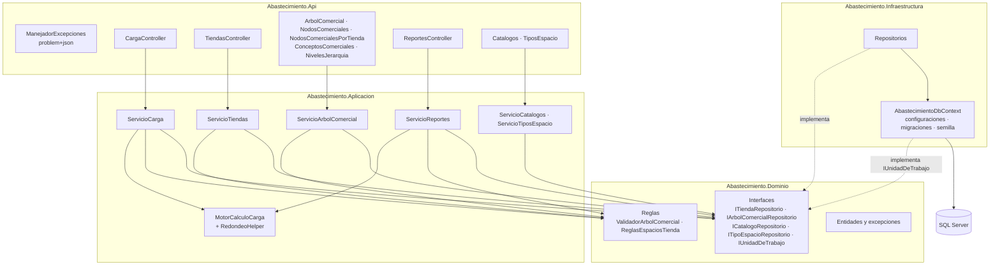
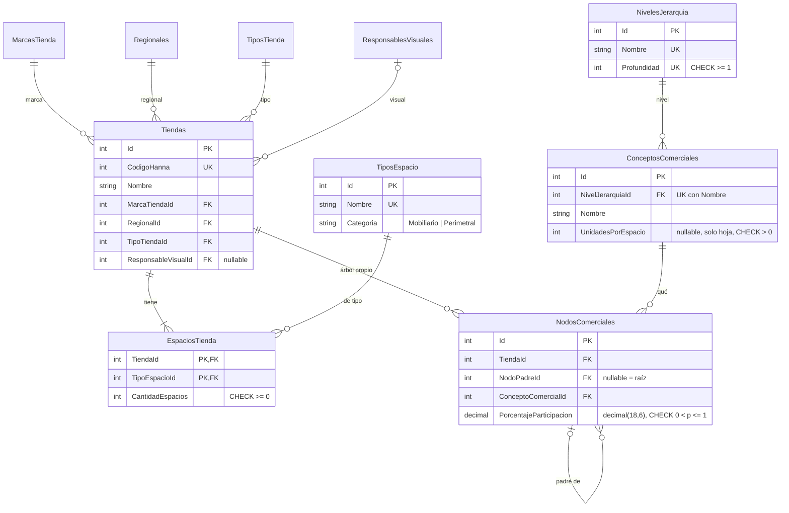
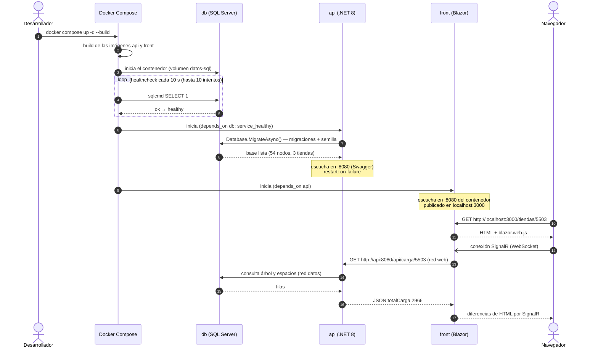

# Abastecimiento Retail — Cálculo de Carga por Tienda

API REST en **.NET 8** que calcula cuántas unidades de cada tipo de producto se envían a una tienda, distribuyendo en
cascada sus espacios físicos según un árbol comercial de 7 niveles. Incluye un **frontend Blazor .NET 8** que consume
la API por HTTP. Se levanta completo con Docker: base de datos + API + front.

| | |
|---|---|
| **Tecnologías** | .NET 8, Clean Architecture, EF Core, SQL Server, Blazor (InteractiveServer) |
| **Pruebas** | **151 backend** (125 unitarias + 26 integración/API) y **117 frontend** — todas pasando |
| **Datos de referencia** | HANNA 5503: 22 espacios → **2.966 unidades** (819/670/482/469/288/238) |
| **Puertos** | Front `3000`, API/Swagger `8080`, SQL Server `14333` |

### Cumplimiento del enunciado

| Requerimiento | Dónde se cumple |
|---|---|
| **R1** Tiendas y mobiliario (hasta 3 muebles + perimetrales, Espacios Totales automáticos) | `POST/GET /api/tiendas` · `Tienda.EspaciosTotales` · `ReglasEspaciosTienda` · [5.2](#52-diseño-relacional-de-los-7-niveles) |
| **R2** Árbol comercial de 7 niveles (% por nodo, Unidades por Espacio en la hoja) | `NivelesJerarquia` · `ConceptosComerciales` · `NodosComerciales` · [5.2](#52-diseño-relacional-de-los-7-niveles) |
| **R3** Motor de cálculo en cascada | `Aplicacion/Motor/MotorCalculoCarga.cs` · [6](#6-supuestos-y-regla-de-redondeo) |
| **R4a** Desglose por producto de una tienda | `GET /api/carga/{codigoHanna}` · [3](#3-probar-la-solución) |
| **R4b** Consolidado por Tienda, Marca o Regional | `GET /api/reportes/consolidado?agruparPor=` · [4](#4-endpoints-swagger) |
| EF Core + SQL Server, migraciones y semilla al iniciar | [2](#2-migraciones-y-semilla-automáticas) |
| SOLID, Clean Architecture y manejo de excepciones | [5.1](#51-arquitectura-clean-architecture) |
| API REST documentada con Swagger | http://localhost:8080/swagger · [4](#4-endpoints-swagger) |
| Datos de prueba: 5503 → **2.966 unidades** | [3](#3-probar-la-solución) |

---

## 1. Compilar y ejecutar

### Con Docker (recomendado)

**Requisito:** tener Docker instalado (ver [Anexo A](#anexo-a-instalación-de-docker)).

```bash
git clone https://github.com/kevinandresforero/AbastecimientoPorTiendaRetail.git abastecimiento_retail
cd abastecimiento_retail
cp .env.example .env          # Windows: copy .env.example .env
docker compose pull db
docker compose up -d --build  # la primera vez descarga ~2 GB de imágenes y tarda 1-2 min
```

- Front: **http://localhost:3000**
- Swagger: **http://localhost:8080/swagger**
- Base de datos: **ya creada y sembrada** (ver [2. Migraciones y semilla](#2-migraciones-y-semilla-automáticas))

Comprobar que todo quedó arriba:

```bash
docker compose ps             # db: healthy, api y front: running
```

Comandos de gestión:

| Acción | Comando |
|---|---|
| Detener (conserva la base) | `docker compose down` |
| Detener y borrar la base | `docker compose down -v` |
| Ver logs de la API | `docker compose logs -f api` |
| Cambiar el puerto de SQL Server | `SQL_PUERTO=14334 docker compose up -d` |

### Sin Docker (alternativa)

Requiere **.NET 8 SDK** y un **SQL Server** accesible:

1. Instalar el SDK: `winget install Microsoft.DotNet.SDK.8` (Windows), `sudo apt install -y dotnet-sdk-8.0` (Ubuntu) o el script oficial `curl -sSL https://dot.net/v1/dotnet-install.sh | bash -s -- --channel 8.0`.
2. Configurar la cadena de conexión en `.env` (`ConnectionStrings__Abastecimiento`).
3. `dotnet run --project src/Abastecimiento.Api --launch-profile http` → Swagger en http://localhost:5080/swagger.

Migración y semilla también se aplican solas al arrancar la API. Ver [2. Migraciones y semilla](#2-migraciones-y-semilla-automáticas).

---

## 2. Migraciones y semilla (automáticas)

**No hay que ejecutar migraciones a mano ni scripts SQL.** Al arrancar, la API hace lo siguiente
(`Api/Extensiones/ExtensionesMigracion.cs`, llamado desde `Program.cs`):

1. `Database.MigrateAsync()` aplica las migraciones pendientes: `MigracionInicial` y `ArbolPorTienda`.
2. La semilla va incluida en esas migraciones (EF Core `HasData` → `InsertData`): catálogos, niveles, conceptos,
   las 3 tiendas y sus **54 nodos** (18 por tienda). Por eso la base queda poblada al primer arranque.

Datos semilla:

| Dato | Valor |
|---|---|
| Tiendas | **5503** (22 espacios), **1001** (30), **2045** (20) |
| Niveles | 7 (Unidad de Negocio … Tipo de Producto) |
| Conceptos | 15 |
| Nodos | 54 (18 por tienda; mismos conceptos y porcentajes, IDs independientes) |

Para recrear la base desde cero (por ejemplo tras tocar la semilla): `docker compose down -v` y
`docker compose up -d --build`. El volumen `datos-sql` es el que conserva los datos entre `down` y `up`.

### 2.1 Schema Nodos Comeriales


### 2.2 Schema Tiendas


---

## 3. Probar la solución

### Resultado esperado (HANNA 5503, 22 espacios)

Ruta: BELLEZA Y BIENESTAR (100 %) → BEAUTY (30 % = 6,6 esp.) → LILI BEAUTY (94 %) / KARITE (6 %) → GIRLS (100 %) →
MAKEUP (100 %) → Perfil → Tipo de Producto.

| Marca | Perfil | Tipo de producto | Esp. calculados | Unid./esp. | Carga |
|---|---|---|---:|---:|---:|
| LILI BEAUTY | LABIOS (40 %) | LABIALES (50 %) | 1,2408 | 660 | **819** |
| LILI BEAUTY | LABIOS (40 %) | BRILLO LABIOS (50 %) | 1,2408 | 540 | **670** |
| LILI BEAUTY | OJOS (45 %) | PESTAÑINA (60 %) | 1,6751 | 288 | **482** |
| LILI BEAUTY | OJOS (45 %) | DELINEADOR (40 %) | 1,1167 | 420 | **469** |
| LILI BEAUTY | ROSTRO (15 %) | BASE / POLVOS (100 %) | 0,9306 | 310 | **288** |
| KARITE | LABIOS (100 %) | BÁLSAMO LABIAL (100 %) | 0,3960 | 600 | **238** |
| | | **Total BEAUTY** | **6,6000** | | **2.966** |

Con la API corriendo, este comando reproduce esa tabla:

```bash
curl -s http://localhost:8080/api/carga/5503
```

Debe devolver `totalCarga` **2966** con 6 líneas (819, 670, 482, 469, 288, 238), igual que la tabla del enunciado.

Otras consultas útiles:

```bash
curl -s http://localhost:8080/api/tiendas/5503/arbol-comercial                     # árbol de la tienda (18 nodos)
curl -s "http://localhost:8080/api/reportes/consolidado?agruparPor=regional"      # BOGOTA / ANTIOQUIA
curl -si http://localhost:8080/api/carga/9999                                     # 404 application/problem+json
```

### Pruebas automatizadas

**Todas las pruebas en un comando (requiere Docker):**

```bash
docker compose --profile pruebas run --rm pruebas
```

- **151 backend**: 125 unitarias + 26 de integración/API contra la base `Abastecimiento_Pruebas` (separada de la de
  la aplicación). Incluye la tabla del enunciado para 5503, 1001 y 2045, redondeo, árbol de 8 niveles, aislamiento
  por tienda, copia de árbol y validaciones de la API.
- **117 frontend**: xUnit + bUnit con clientes falsos (sin API real ni BD). Incluye componentes, formularios,
  porcentajes, contraste de tema y reglas de arquitectura (sin `@code` en `.razor`, sin `HttpClient` en componentes,
  sin referencias al backend).

Alternativas con el SDK de .NET 8 instalado:

```bash
dotnet test                     # 125 unitarias (las 26 de BD aparecen omitidas)
ABASTECIMIENTO_PRUEBAS_SQL="Server=localhost,14333;Database=Abastecimiento_Pruebas;User Id=sa;Password=Abastecimiento#2026;TrustServerCertificate=True" dotnet test   # todas
dotnet test front/Abastecimiento.Front.sln   # 117 del front
```

---

## 4. Endpoints (Swagger)

| Método y ruta | Descripción | Respuestas |
|---|---|---|
| `GET /api/carga/{codigoHanna}` | Desglose de carga de una tienda (R3, R4a) | 200 / 404 |
| `GET /api/tiendas/{codigoHanna}/arbol-comercial` | Árbol de la tienda en preorden (vacío si no tiene) | 200 / 404 |
| `POST /api/tiendas/{destino}/arbol-comercial/copiar-desde/{origen}` | Copia el árbol de otra tienda (solo destino vacío) | 201 / 400 / 404 / 409 |
| `POST /api/tiendas/{codigoHanna}/nodos-comerciales` | Crea un nodo en el árbol de la tienda | 201 / 400 / 404 / 409 |
| `PUT /api/nodos-comerciales/{id}/porcentaje` | Cambia el % de un nodo | 200 / 400 / 404 |
| `GET /api/reportes/consolidado?agruparPor=tienda\|marcaTienda\|regional\|nivel&nivelId=` | Consolidado (R4b) | 200 / 400 |
| `GET /api/tiendas?marcaTiendaId=&regionalId=` | Listado de tiendas | 200 |
| `POST /api/tiendas` | Crea una tienda (nace sin árbol) | 201 / 400 / 409 |
| `GET /api/niveles-jerarquia`, `GET/POST /api/conceptos-comerciales` | Catálogos del árbol | 200 / 201 |

Todos los endpoints están documentados en **Swagger** con comentarios XML y códigos de respuesta. Los errores usan
`application/problem+json` (RFC 7807): 400 datos inválidos, 404 no existe, 409 duplicado/conflicto.

---

## 5. Decisiones técnicas

### 5.1 Arquitectura (Clean Architecture)



Las dependencias apuntan hacia el Dominio: `Api → Aplicacion → Dominio ← Infraestructura`.

| Proyecto | Responsabilidad |
|---|---|
| `Abastecimiento.Dominio` | Entidades, reglas puras (`ValidadorArbolComercial`, `ReglasEspaciosTienda`), excepciones e interfaces de repositorio. Sin dependencias. |
| `Abastecimiento.Aplicacion` | Motor de cálculo puro, servicios (devuelven DTOs), helpers y DTOs. Depende solo de Dominio. |
| `Abastecimiento.Infraestructura` | EF Core + SQL Server: `DbContext`, configuraciones, migraciones, semilla y repositorios. |
| `Abastecimiento.Api` | Controllers delgados, Swagger y manejador global de excepciones. |

Principios: **SOLID** (una interfaz y responsabilidad por servicio), inyección de dependencias, sin MediatR/AutoMapper/
FluentValidation (DataAnnotations para la forma + reglas de dominio para el negocio).

**Manejo de excepciones:** el Dominio lanza `ValidacionDominioExcepcion`, `NoEncontradoExcepcion` y
`ConflictoExcepcion`; `Api/Middleware/ManejadorExcepciones.cs` las traduce a `application/problem+json`
(400, 404 y 409; una violación de restricción de BD también es 409 y cualquier otro error, 500 sin detalles internos).

### 5.2 Diseño relacional de los 7 niveles

Los niveles **son datos, no columnas ni tablas por nivel**: la jerarquía se modela con una lista de adyacencia
(`NodoPadreId`) y una tabla de niveles. Agregar un 8.º nivel, una categoría o una tienda es insertar filas, sin
migraciones (hay una prueba con un árbol de 8 niveles).



| Tabla (esquema) | Qué guarda | Por qué así |
|---|---|---|
| `NivelesJerarquia` (`nodoscomerciales`) | Los 7 niveles con su `Profundidad` (1 = Unidad de Negocio … 7 = Tipo de Producto) | El nivel hoja se deriva (mayor profundidad); no hay "7" fijo en el código |
| `ConceptosComerciales` | El **qué**: BEAUTY, LILI BEAUTY, LABIALES… con su nivel; `UnidadesPorEspacio` solo en la hoja | Se comparten entre tiendas; único por (nivel, nombre) |
| `NodosComerciales` | El **dónde y cuánto**: concepto + padre + % de participación, por tienda | Lista de adyacencia: profundidad libre; índices únicos (padre, concepto) y (tienda, concepto) para raíces |
| `Tiendas` + catálogos (`tiendas`) | HANNA, nombre, marca, regional, tipo y visual responsable | Catálogos normalizados con FK `Restrict` |
| `EspaciosTienda` + `TiposEspacio` | Cantidad de espacios por tipo (Isla, Mesa… o Perimetral) | Hasta 3 muebles + perimetral (`ReglasEspaciosTienda`); `EspaciosTotales` se **calcula**, no se guarda |

Las reglas que el esquema no puede expresar (suma de hermanos ≤ 1, padre de la misma tienda y del nivel
inmediatamente superior) las valida `ValidadorArbolComercial` en el Dominio. El esquema `auth` (usuarios, roles,
sesiones) existe en la base pero queda fuera de alcance.

#### Árboles comerciales independientes por tienda

- Cada tienda tiene **su propio árbol** (`NodosComerciales.TiendaId`); los nodos son independientes: editar una tienda
  no modifica a otra. Los conceptos (el "qué") se comparten; los nodos y porcentajes (el "dónde" y "cuánto") son de
  cada tienda.
- **Tienda nueva = árbol vacío.** `POST /api/tiendas` no crea nodos.
- **Copia de árbol** (`copiar-desde`): clona la estructura y los porcentajes con **IDs nuevos**, solo si el destino está
  vacío. Los árboles copiados son independientes.
- Al crear un nodo, el padre debe pertenecer a la misma tienda; la raíz debe ser de profundidad 1.
- El nivel hoja **se deriva** de `NivelesJerarquia` (mayor `Profundidad`), no está fijo en el código.

### 5.3 Despliegue


La `api` está en las dos redes; el `front` solo está en `web`, así que únicamente ve a la API y no puede alcanzar la
base de datos.

### 5.4 Docker en ejecución

Qué pasa desde `docker compose up -d --build` hasta que un usuario consulta una carga:



Con `docker compose down` se detienen los tres contenedores y los datos se conservan en `datos-sql`; con
`down -v` también se borra el volumen y el siguiente `up` vuelve a migrar y sembrar.

---

## 6. Supuestos y regla de redondeo

### Regla de redondeo

- **Un solo punto de redondeo:** la carga total de cada línea (`Aplicacion/Helpers/RedondeoHelper.cs`). Los espacios de
  la cascada y la carga calculada conservan todos sus decimales.
- **Por defecto:** entero más cercano, empates hacia arriba (`MidpointRounding.AwayFromZero`). Configurable en
  `appsettings.json` (`Calculo:ModoRedondeo`) o con `Calculo__ModoRedondeo`: `ToEven` (bancario) o `ToZero`.
- **Total de la tienda** = suma de las líneas ya redondeadas.
- Con la semilla: 5503 da 2.966 (sobre 2.966,49 exactas) y 2045 da 2.696 (sobre 2.696,81); 1001 asigna 4.046 sobre
  4.045,2156 exactas (hasta medio espacio por encima del valor exacto por línea). Si el negocio no admite exceso,
  usar `ToZero`.

### Precisión decimal

| Dónde | Tipo | Decimales |
|---|---|---|
| Cálculo y respuestas de la API | `decimal` (C#) | hasta 28 (base 10 exacta: 0,3 y 0,94 sin error binario) |
| `NodosComerciales.PorcentajeParticipacion` (BD) | `decimal(18,6)` | 6 (fracción: 0,300000 = 30 %) |
| Espacios y unidades por espacio | `int` | 0 |

Los espacios y cargas calculados **no se guardan** en la BD: se calculan en cada consulta.

### Otros supuestos

- **Suma de hermanos ≤ 1** (no = 1): la semilla es parcial (BEAUTY = 30 % sin categorías hermanas).
- **Ramas incompletas:** se devuelven con `advertencias[]`, no como error.
- **Fuera de alcance:** editar/eliminar tiendas y nodos, autenticación y autorización (los roles son solo datos).

---

## 7. Frontend

Blazor Web App **.NET 8** (`front/Abastecimiento.Front`) con render **InteractiveServer**. Consume la API **solo por
HTTP** desde el servidor de Blazor (no desde el navegador), así que no depende de CORS ni expone la URL de la API.
**No referencia ningún proyecto del backend**: los contratos JSON están copiados como `record` en `front/Abastecimiento.Front/Contratos/`.

| Pantalla | Ruta | Qué hace |
|---|---|---|
| Inicio | `/` | Buscador por HANNA → detalle de tienda |
| Tiendas | `/tiendas` | Listado con filtros por marca/regional |
| Nueva tienda | `/tiendas/nueva` | Alta de tienda (nace sin árbol) |
| Detalle y carga | `/tiendas/{hanna}` | Datos, espacios y carga calculada; enlaza al árbol |
| Árbol comercial | `/arbol?tienda={hanna}` | Selector de tienda, vista árbol/tabla, edición de %, copia |
| Reportes | `/reportes` | Consolidado por tienda, marca, regional o nivel |
| Catálogos | `/catalogos` | Marcas, regionales, tipos de tienda, tipos de espacio |

Detalles de decisiones del front (capas, validadores, formato de porcentajes, tema) están en
`front/Abastecimiento.Front/` y en las pruebas de `front/tests/Abastecimiento.Front.Pruebas/`.

---

## Anexo A. Instalación de Docker

| Sistema | Cómo |
|---|---|
| **Windows 10/11** | Instalar **WSL 2**: `wsl --install` (reiniciar). Después `winget install Docker.DockerDesktop` y abrir Docker Desktop hasta que diga *Engine running*. |
| **macOS** | Instalar [Docker Desktop](https://www.docker.com/products/docker-desktop/). En **Apple Silicon (M1/M2/M3)** activar *Settings → General → "Use Rosetta for x86_64/amd64 emulation"* (la imagen de SQL Server es amd64). |
| **Linux (Ubuntu)** | Docker Engine + plugin compose según [docs.docker.com/engine/install](https://docs.docker.com/engine/install/ubuntu/); luego `sudo usermod -aG docker $USER` y cerrar/abrir sesión. |

Comprobar:

```bash
docker --version          # p. ej. Docker version 27.x
docker compose version    # debe mostrar la versión 2.x
```

Requisitos del equipo: **4 GB de RAM libres** (SQL Server pide mínimo 2 GB) y los puertos 8080, 14333 y 3000 libres.

## Anexo B. Solución de problemas

| Síntoma | Causa y solución |
|---|---|
| `port is already allocated` (14333 u 8080) | Otro programa usa el puerto. SQL: `SQL_PUERTO=14334 docker compose up -d`. API: liberar el 8080. |
| `db` no pasa a *healthy* | Poca memoria (SQL Server necesita 2 GB) o contraseña débil: `MSSQL_SA_PASSWORD` debe tener 8+ caracteres con mayúsculas, minúsculas, números y símbolos. Revisar `docker compose logs db`. |
| La API se reinicia al arrancar | Normal: arranca cuando `db` está *healthy* (`restart: on-failure`). Esperar. |
| `Login failed` / error de red | Cadena de conexión o SQL Server apagado: revisar `ConnectionStrings__Abastecimiento` en `.env`. |
| `The certificate chain was issued by an authority that is not trusted` | Falta `TrustServerCertificate=True` en la cadena. |
| `You must install or update .NET ...` | Instalar .NET 8 o anteponer `DOTNET_ROLL_FORWARD=Major` si solo hay una versión más nueva. |
| Apple Silicon: `no matching manifest for linux/arm64` | Activar Rosetta en Docker Desktop (Anexo A). |
| El front recibe error de CORS | Agregar el origen en `appsettings.json` → `Cors:OrigenesPermitidos` o `Cors__OrigenesPermitidos__3=http://localhost:<puerto>`. |
| El front en Docker no carga | Verificar `Api__UrlBase=http://api:8080` y que la API esté *running* (`docker compose ps`). |

## Anexo C. Estructura del repositorio

```
src/
  Abastecimiento.Dominio/          Entidades, reglas, excepciones, interfaces
  Abastecimiento.Aplicacion/       Motor de cálculo, servicios, helpers, DTOs
  Abastecimiento.Infraestructura/  EF Core: DbContext, migraciones, semilla, repositorios
  Abastecimiento.Api/              Controllers, Swagger, middleware, Program.cs
front/
  Abastecimiento.Front/            Blazor: componentes, clientes HTTP, contratos, formularios
  Abastecimiento.Front.Pruebas/    117 pruebas xUnit + bUnit
tests/
  Abastecimiento.Pruebas/          151 pruebas (unitarias, integración SQL Server y API)
```
